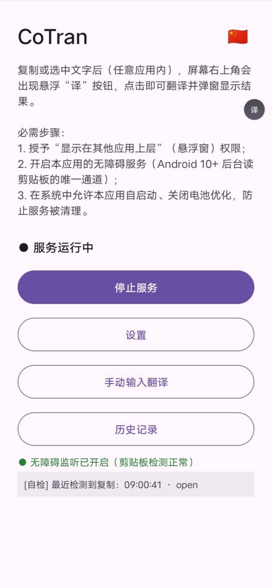
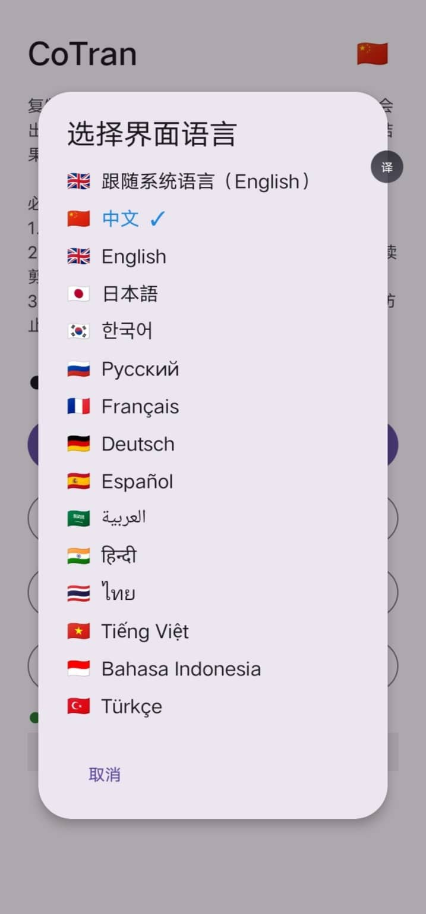
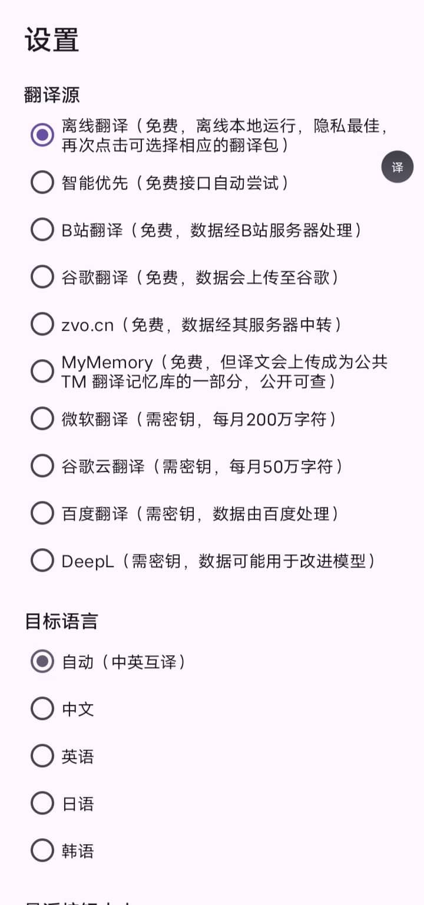
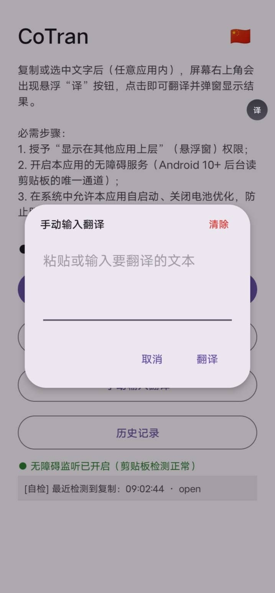
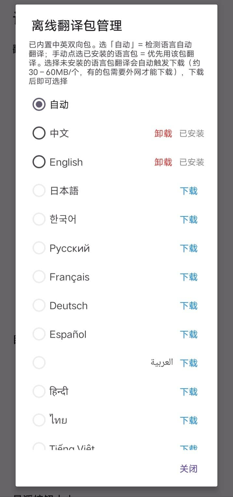

<div align="center">


# CoTran

**Copy · Translate · Anywhere**

Copy-to-translate — a lightweight floating translator for any Android app

[](https://github.com/wob25/CoTran/releases)
[](https://www.android.com/)
[](https://developer.android.com/about/versions/oreo)
[](https://developers.google.com/ml-kit/language/translation)
[](LICENSE)
[](https://github.com/wob25/CoTran/pulls)

</div>

<div align="center">

**English** | [简体中文](README.zh-CN.md)

</div>

---

## 📸 Screenshots

| Home | Interface Language | Settings |
|:---:|:---:|:---:|
|  |  |  |
| **Manual Translation** | **Offline Language Packs** | **History** |
|  |  |  |

---

## ✨ Features

- 🔔 **Copy to translate** — after copying or selecting text, a floating “译” button appears on screen; tap it to translate instantly
- 📴 **Fully offline** — built-in ML Kit Chinese–English models (43MB); ready to use right after install, data never leaves the device
- 🌐 **Multi-provider** — smart fallback across free engines (Bilibili / Google / MyMemory…), plus official APIs (Microsoft / Google Cloud / Baidu / DeepL)
- 🗣️ **68 languages** — offline pack manager: download, uninstall and pin target languages on demand
- 🪟 **Floating panel** — fixed 85% screen-height panel, independent scrolling for source & result, tap anywhere outside to dismiss
- 🎨 **Personalization** — adjustable floating button size (24–64dp) and background opacity (10%–100%) with live preview sliders
- 🕘 **Local history** — last 100 translations, searchable, copyable, deletable
- 🛡️ **Privacy first** — offline engine keeps data on-device; every online provider is labeled with its privacy policy

## 📥 Installation

### Option 1: Download from Releases

Grab the latest signed `app-release.apk` from the [Releases](https://github.com/wob25/CoTran/releases) page and install it.

### Option 2: Build from source

```bash
git clone https://github.com/wob25/CoTran.git
cd CoTran
# Open in Android Studio and Run, or:
./gradlew :app:assembleRelease
# Output: app/build/outputs/apk/release/app-release.apk
```

> **Requirements**: Android Studio (bundled JBR) · SDK Platform 34 · minSdk 26 (Android 8.0+)

## 🚀 Quick Start

1. Open the app → grant **overlay permission** and **accessibility permission**
2. Tap “开启服务” — both foreground services start automatically
3. **Copy or select** any text in any app → the floating “译” button appears
4. Tap the button → the panel auto-fills and translates → the result label shows which provider translated it
5. Tap anywhere outside the panel to dismiss

## 🔐 Permissions

| Permission | Purpose | Required |
| --- | --- | --- |
| Overlay | Show the floating button & panel | Yes |
| Accessibility | Clipboard detection channel on Android 10+ | Yes |
| Notifications | Foreground service notifications | Recommended |
| Battery optimization exemption | Keep services alive | Recommended |

## 🌐 Providers & Privacy

| Provider | Cost | Privacy |
| --- | --- | --- |
| **Offline (ML Kit)** ⭐ | Free | Runs entirely on-device, no data leaves your phone |
| Smart priority | Free | Tries free engines in order; data goes to the one that succeeds |
| Bilibili | Free | Data processed via Bilibili servers |
| Google (gtx) | Free | Unofficial endpoint, data uploaded to Google |
| zvo.cn | Free | Third-party relay server |
| MyMemory | Free | Translations become part of the public TM memory |
| Microsoft | API key | Official API, F0 tier: 2M chars/month free |
| Google Cloud | API key | Official API, ~500K chars/month free tier |
| Baidu | API key | Official API, per Baidu privacy policy |
| DeepL | API key | Official API, free tier may use data to improve models |

> If an official provider is selected without a key, the app automatically falls back to free providers — translation never gets stuck.

## 🧩 Offline Language Packs

Settings → Provider → “Offline Translation” opens the pack manager:

- **Chinese–English pack is bundled** in the APK — works offline out of the box
- 60+ other language packs (Russian, Japanese, Korean, French, German, Spanish…) downloadable on demand, ~30–45MB each
- View install status, download with live progress, uninstall, and pin a target language

## 📁 Project Structure

```
CoTran/
├── app/src/main/
│   ├── java/com/copytranslate/app/
│   │   ├── App.kt                             # Global Application
│   │   ├── service/
│   │   │   ├── ClipboardAccessibilityService.kt  # Selection / clipboard detection
│   │   │   ├── ClipboardMonitorService.kt        # Clipboard listener foreground service
│   │   │   ├── FloatingButtonService.kt          # Floating button & translate panel
│   │   │   └── BootReceiver.kt                   # Boot auto-start
│   │   ├── translate/
│   │   │   ├── TranslateManager.kt               # Entry: provider chain / fallback / chunking
│   │   │   ├── TranslateProvider.kt              # Provider interface + Http helper
│   │   │   └── provider/                         # 10 provider implementations
│   │   │       ├── OfflineMlKitProvider.kt           # ML Kit on-device
│   │   │       ├── MlKitModelWarmer.kt               # Offline model seeding / warm-up
│   │   │       ├── BiliIndexProvider.kt              # Bilibili Index-Translate
│   │   │       ├── GoogleGtxProvider.kt              # Google gtx
│   │   │       ├── GoogleCloudProvider.kt            # Google Cloud official v2
│   │   │       ├── MicrosoftProvider.kt              # Microsoft official v3
│   │   │       ├── ZvoProvider.kt / MyMemoryProvider.kt
│   │   │       └── BaiduProvider.kt / DeepLProvider.kt
│   │   ├── ui/
│   │   │   ├── MainActivity.kt                   # Entry: service toggle / permission guide
│   │   │   ├── SettingsActivity.kt               # Settings (providers / packs / sliders)
│   │   │   ├── HistoryActivity.kt                # History list
│   │   │   └── ResultOverlay.kt                  # Floating translate panel
│   │   ├── util/                                 # Prefs / clipboard gate / language detect
│   │   └── db/HistoryRepository.kt               # History storage
│   ├── assets/mlkit_models/                      # Bundled Chinese–English models
│   └── res/                                      # Layouts / icons / strings
├── assets/                                       # README assets (logo / screenshots)
├── gradle/                                       # Gradle Wrapper
└── LICENSE                                       # MIT License
```

## ⚠️ Known Limitations

- Android 10 and later versions restrict background access to the clipboard; this app bypasses that limitation by using an accessibility service. On some devices, the system ROM enforces strict background process management; in certain cases, you may need to tap the "Refresh" button within the panel to retrieve the latest content.
- Text inside self-drawn terminal apps (e.g. Termux) cannot be captured by accessibility; use the manual input dialog instead
- Downloading online language packs requires network access to Google servers

## 🤝 Contributing

Issues and Pull Requests are welcome! Provider adaptations, UI improvements and bug reports are all appreciated.

## 📄 License

Licensed under the [MIT License](LICENSE).

---

<div align="center">

**If this project helps you, please consider giving it a ⭐ Star**

</div>
